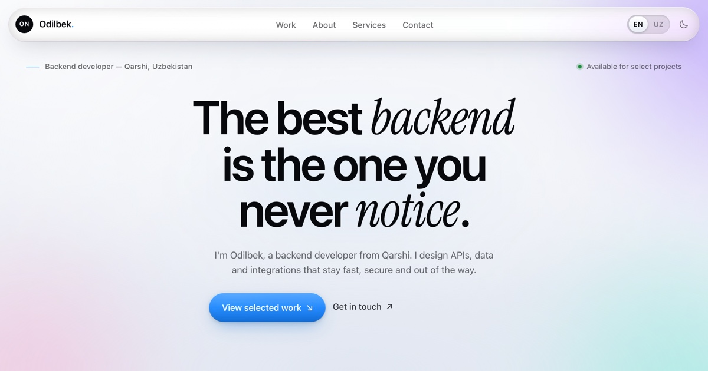

# Odilbek Normurodov — Portfolio

Personal portfolio for **Odilbek Normurodov**, a backend developer based in
Qarshi, Uzbekistan. A static, motion-first site with no build step, no
framework and no tracking.

**Live:** <https://normurodov-org.github.io/odil-dev/>



## Stack

- Semantic HTML, hand-written CSS and vanilla JavaScript
- [Lenis](https://github.com/darkroomengineering/lenis) for smooth scrolling
- [GSAP](https://gsap.com/) + ScrollTrigger for the entrance sequence,
  reveals and counters
- Self-hosted **Inter Tight** and **Instrument Serif** (no Google Fonts)
- Everything is vendored in `vendor/` — the site has no runtime CDN dependency

## Run locally

```bash
cd path/to/odil-dev
python3 -m http.server 4173
```

Open <http://localhost:4173>. A local server is recommended so fonts, images
and `fetch`-free assets load with the right headers. Double-clicking
`index.html` also works.

## Structure

```
index.html            markup, metadata, copy keys
styles.css            design tokens, layout, responsive rules, themes
main.js               i18n, theme, tab bar, reveals, clock, form, light
vendor/               Lenis, GSAP and ScrollTrigger (local copies)
assets/fonts/         Inter Tight + Instrument Serif (woff2)
assets/projects/      project screenshots (full + 720px JPEG/WebP variants)
assets/favicon.svg    logo mark
assets/favicon-32.png, assets/apple-touch-icon.png
assets/og-image.jpg   1200×630 social preview
glass/                standalone Liquid Glass study (reference implementation)
LIQUID-GLASS.md       the material + motion playbook
404.html              self-contained GitHub Pages error page
robots.txt, sitemap.xml
```

## Editing

- **Copy / translations** — edit the text in `index.html` and the matching
  strings in the `copy` object at the top of `main.js` (English and Uzbek).
  Keep both languages in sync.
- **Projects** — update the `.project` blocks in `index.html` and the
  screenshots in `assets/projects/`. Each card carries its own artwork; keep the
  `-720.jpg` / `-720.webp` variants for small screens.
- **Services / toolbox** — edit the Services section in `index.html`; the
  lists are plain markup.
- **Colours and type** — the palette and type stacks live in the `:root` and
  `html[data-theme="dark"]` blocks at the top of `styles.css`.
- **Contact form** — it validates locally and opens the visitor's email app
  with a prefilled message (`mailto:`). No data is stored. To use a form
  service instead, replace the submit handler in `main.js`.
- **Social links and email** — update them in the header menu, contact section
  and footer of `index.html`, and in `main.js` for the copy-to-clipboard
  address.

## Design — Liquid Glass

The site follows Apple's Liquid Glass language (iOS 26 / macOS Tahoe 26): a
floating glass navigation bar, a mobile tab bar with a morphing selection pill,
pointer-lit rim highlights and specular sheen, a tinted-glass primary action, a
circular theme reveal and spring motion throughout. One rule shapes it: **glass is the
control layer, content stays solid and legible.** The dock also re-tints itself
when it floats over the dark contact slab.

[`LIQUID-GLASS.md`](LIQUID-GLASS.md) explains the principles, the CSS recipes,
the motion specs, performance limits and accessibility. `glass/` keeps the
original standalone study — its own CSS and JS — as a reference implementation:

```bash
python3 -m http.server 4173   # then open /glass/
```

## Deploy

The site is deployed with **GitHub Pages** from the `main` branch (root
folder). Any push to `main` republishes it.

To use a custom domain:

1. Add a `CNAME` file with the domain.
2. Update the absolute URLs in `index.html` (`canonical`, `og:url`,
   `og:image`, Twitter meta, JSON-LD), `robots.txt`, `sitemap.xml` and the
   `/odil-dev/` links inside `404.html`.

## Accessibility and performance

- Skip link, visible focus styles, labelled controls, `aria-current`
  navigation state, a mobile tab bar and a solid fallback under
  `prefers-reduced-transparency`
- `prefers-reduced-motion` disables the loader, smooth scrolling, pointer
  light and decorative animation, and renders all content immediately
- Theme and language preferences persist in `localStorage`; the intro loader
  runs once per session on larger screens and is skipped on phones, save-data
  and slow connections
- WCAG AA contrast for body and interface text in both themes
- Project images are lazy-loaded, with 720px JPEG/WebP variants on small
  screens; fonts are preloaded and self-hosted

## Contact

- Email: <normurodovodilbek3110@gmail.com>
- GitHub: <https://github.com/normurodov-org>
- Telegram: <https://t.me/normuzb>

---

© 2026 Odilbek Normurodov. Code and content are original work unless noted.
